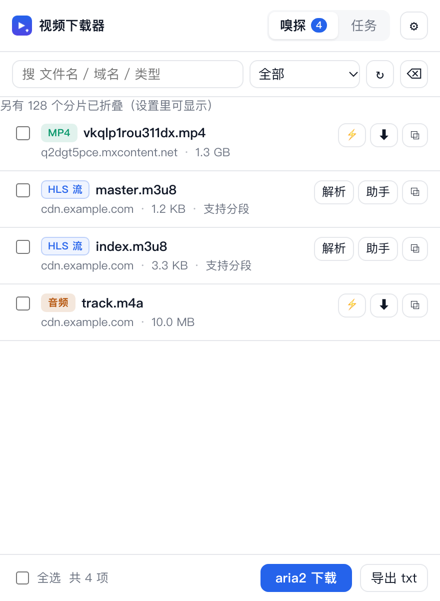
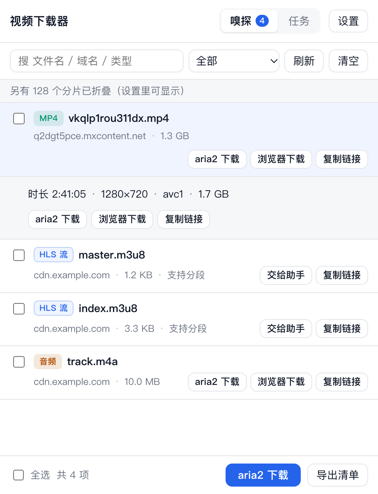
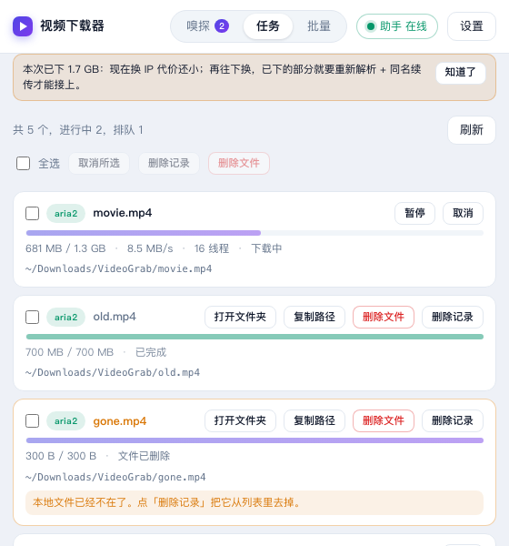
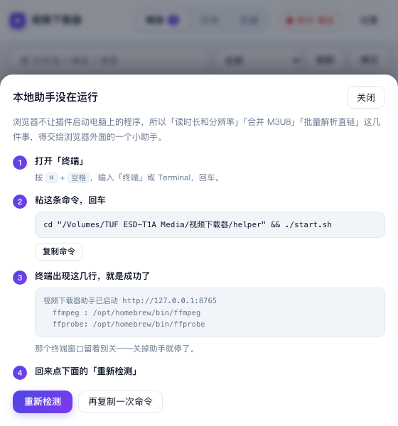
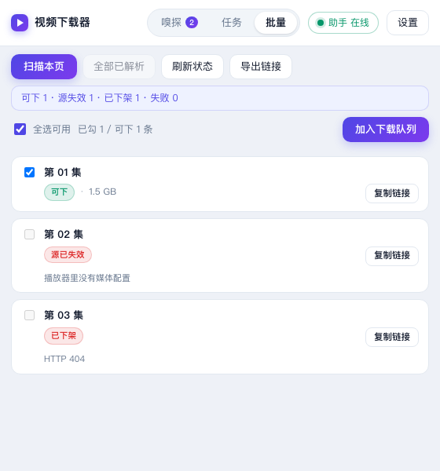
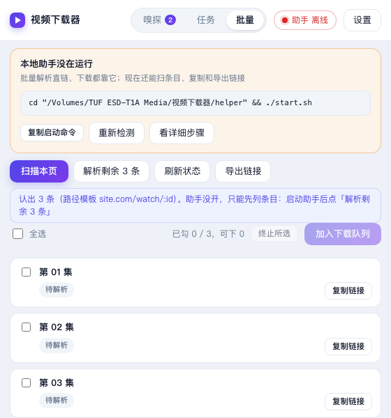

# 视频下载器 VideoGrab

Chrome 扩展 + 本地助手。嗅探页面里的 **MP4 / M3U8 / DASH / WebM / TS** 等媒体，
把捕获到的**真实 Referer、User-Agent、Cookie** 一起交给 **aria2**（多线程）或 **ffmpeg**（流合并），
不用再手动 Copy as cURL、不用记那一长串参数。



<sub>列表：全文字按钮，MP4 直接 aria2，HLS 交给助手或拿 ffmpeg 命令</sub>

---

## 解决什么问题

| 原来的痛点 | 现在 |
|---|---|
| 浏览器单连接下载，被 CDN 按连接限速，1.3 GB 要几小时 | 扩展把完整请求头交给 aria2，`-x16 -s16` 多线程，通常几分钟 |
| 直链有防盗链，浏览器能下、curl 403 | 头是从页面请求里抓的，原样转发，403 自然消失 |
| M3U8 要记 `-protocol_whitelist` / `-extension_picky 0` 一长串 | 解析后一键复制命令，或直接交给助手跑 |
| 一页里好几个视频，要一个个复制 | 勾选批量入队 / 导出 aria2 `-i` 任务文件 |
| 文件名是乱码，看不出是哪个视频 | 点名称展开详情：只读文件头 256 KB，3~5 秒出时长、分辨率、编码 |



<sub>点名称展开：时长 + 分辨率 + 编码 + 大小，HLS 还会多一行分片/加密信息</sub>



<sub>任务按状态给不同按钮：进行中是「暂停 / 取消」，已完成和出错是「删除文件 / 删除记录」</sub>

---

## 安装

### 1. 扩展

Chrome 里打开 `chrome://extensions` → 右上角打开「开发者模式」→「加载已解压的扩展程序」→ 选本仓库的 `extension/` 目录。

> Google Chrome 品牌版从 137 起禁止了 `--load-extension` 命令行侧载，只能这样手动加载。
> 快捷键 `Alt+Shift+V` 可以直接呼出面板。

### 2. aria2（MP4 多线程，强烈建议）

```bash
brew install aria2
aria2c --enable-rpc --rpc-allow-origin-all --rpc-listen-all=false \
  --continue=true --max-connection-per-server=16 --split=16 --min-split-size=1M
```

想要开机自启就 `brew services start aria2`，并把上面参数写进 `~/.aria2/aria2.conf`。
装完在扩展「设置」里点 **测试 aria2**，看到版本号就通了。

### 2.5 代理（自动跟随系统）

不少站的签名链接**绑定出口 IP**：浏览器走代理拿到的链接，aria2/ffmpeg 直连就 403。

默认模式是 **自动跟随系统**：助手读 macOS 的 `scutil --proxy`，你开着代理就走代理，关了就直连。
不需要手动填任何东西。

设置页可以改成：

| 模式 | 行为 |
|---|---|
| 自动跟随系统（默认） | 读系统代理，端口在听就用，否则直连 |
| 永远不用代理 | 适合完全能直连的站 |
| 手动指定 | 填死一个地址，比如 `http://127.0.0.1:7897` |

注意：**能直连的站别让它走代理**，绕远路反而慢。所以"自动"比"填死地址"更合适。



<sub>助手没开时点「交给助手」，会直接弹出这四步；第 4 步点「重新检测」能立刻知道连上没有</sub>

### 3. 本地助手（M3U8 合并，可选）

```bash
cd helper
./start.sh          # 前台跑，Ctrl+C 停
```

想常驻（开机自启）：

```bash
sed "s#__HELPER_PATH__#$PWD#" helper/com.videograb.helper.plist > ~/Library/LaunchAgents/com.videograb.helper.plist
launchctl load ~/Library/LaunchAgents/com.videograb.helper.plist
```

助手只监听 `127.0.0.1:8765`，不对外。默认输出到 `~/Desktop`，可在设置里改。

---

## 用法

1. 打开播放页，点一次播放（让请求真的发出去）。
2. 点扩展图标。列表里出现媒体：类型、大小、域名。
3. **点名称（或整行）展开详情**：助手只读文件开头 256 KB，自己解析 MP4 索引，3~5 秒给出时长、分辨率、编码。
   不走 ffmpeg 解码整段视频，所以不用等。
4. **MP4 / WebM 这类完整文件** → 点 `aria2 下载`（多线程）；没开 aria2 就先 `浏览器下载`。
5. **M3U8 / DASH** → 展开后点 `复制 ffmpeg 命令` 粘到终端，或 `交给助手` 后台跑，进度在「任务」里看。
6. **批量**：勾选多条 → `aria2 下载`；或 `导出清单` 后在终端 `aria2c -i 那个文件.txt`。
7. **列表页批量抓（不用点开视频）**：切到「批量」页 → `扫描本页`，扫完会**自动开始解析**（5 条一批，进度在列表上方）→ 勾选「可下」→ `加入下载队列`。
   列表常常是懒加载的，所以链接是从页面 DOM 里读的，不是猜的。解析结果分三种：可下 / 源已失效（托管端没文件了）/ 已下架（页面 404）。
   只有解析出地址的条目能勾选；结果（连勾选一起）存在 `storage.session` 里，弹窗关了再打开还在，**没解析完的会自动接着解析**。
   解析按钮自己写明还剩多少活（`解析剩余 N 条` / `重试失败 N 条`）；你手动改过勾选后，后面解析出来的条目不会再被自动勾上。
   **助手没开也能用批量**：照样扫得出条目、能逐条「复制链接」、能「导出链接」；解析直链和下载才需要助手，
   那时批量页顶部会挂一张引导卡（复制启动命令 / 重新检测 / 看详细步骤）。



<sub>批量：扫描完自动解析，状态分「可下 / 源已失效 / 已下架 / 解析失败」，全选支持半选态</sub>



<sub>助手没开时：条目照样列出来，顶部引导卡告诉你怎么启动，链接可以先复制或导出</sub>
8. **任务面板**：
   - 进行中 → 「暂停 / 取消」
   - 已完成 / 出错 → 「删除文件」（连磁盘文件一起删，有二次确认）、「删除记录」（只从列表里去掉，文件还在）
   - **批量**：每行左侧勾选（不限状态），顶部一条给「取消所选 / 删除记录 / 删除文件」，
     按钮按勾中任务的状态自动开关：勾着进行中的只能取消，勾着已完成的才能删文件。
     清记录一次消息处理一批，删文件走助手白名单，同一个接口，不额外开口子。
   - **换 IP 提醒**：点任何下载动作之前，会先告诉你「这些直链绑当前出口 IP，中途换节点会全部 403」；
     任务面板顶部还有一条提示：累计下到 300 MB 时提醒「现在换 IP 代价还小」，某个任务连续 3 分钟
     低于 20 KB/s 时提醒「多半是按 IP 限速，换节点要重新解析 + 同名续传」。
   - 助手合并的任务同样是这一套；已完成但本地文件被你删了的，会显示「文件已删除」而不是「已完成」

分片 `.ts` 默认折叠，设置里可以打开。

---

## 目录

```
extension/          Chrome 扩展（MV3）
  manifest.json
  background.js     嗅探 webRequest、调度下载、aria2 RPC
  common.js         类型识别、m3u8 解析、参数/命令生成
  popup.*           主面板
  options.*         设置页
  icons/
helper/             本地助手（Node，无依赖）
  server.mjs        /api/health /api/parse /api/jobs /api/scan /api/resolve
  extract.mjs       通用媒体发现器（直出 / 打包配置 / 播放器嵌入），纯函数
  start.sh
  com.videograb.helper.plist
tools/              自测
  extract-test.mjs  通用发现器（合成 HTML，不联网）
  selftest.mjs      common + background 逻辑（假 chrome API）
  popup-test.mjs    弹窗渲染（jsdom）
  shot.mjs          UI 截图（Chrome 无头 + 假数据，渲染各面板状态）
  cdp-test.mjs      真浏览器端到端（需要 Chromium，品牌版 Chrome 不行）
```

---

## 自测

```bash
node tools/extract-test.mjs  # 47 项：通用发现器 + aria2 错误提取 + 文件名去重，全合成数据
node tools/selftest.mjs      # 87 项：类型识别、m3u8、aria2 参数、ffmpeg 命令、嗅探逻辑、批量兜底、批量取消/清记录/删文件
node tools/popup-test.mjs    # 110 项：列表渲染、详情、任务面板、批量删除、筛选、批量面板、勾选、助手引导
node tools/shot.mjs          # 出图：screenshots/ 下的界面截图就是它生成的，改完全局样式先跑它看效果
```

`popup-test.mjs` 依赖 jsdom，先 `mkdir -p /tmp/vgdom && cd /tmp/vgdom && npm i jsdom`。

---

## 排错

| 现象 | 原因 / 处理 |
|---|---|
| 列表是空的 | 页面还没真正请求视频：点一下播放；或该页用的是 `blob:`，去设置里打开「显示分片」找 m3u8 |
| 条目上显示 `HTTP 403` | 链接是签名直链且已过期，重新播放页面拿新链接 |
| `⚡` 报 aria2 连不上 | aria2 没开 RPC，或端口/密钥和设置页不一致 |
| `交给助手` 没反应 | 助手没启动：`cd helper && ./start.sh` |
| HLS 解析失败 | 播放列表本身要 Referer：让助手在线（它带 Referer），扩展自己直连时不带头 |
| 下载完是 548 字节的小文件 | 那就是 403 错误页，说明头没带对或链接过期 |
| 下载很慢 | 设置里把连接数调到 16；有些 CDN 按 IP 限速，加连接没用 |
| 启动助手报 `EADDRINUSE` | 不是失败，是**已经在跑了**；用 `curl -s http://127.0.0.1:8765/api/health` 确认 |
| 展开后一直「抓预览帧…」 | 助手没在跑，或源站很慢；先 `cd helper && ./start.sh` |
| 预览报 403，但浏览器能播 | **链接绑出口 IP**：浏览器走代理拿的链接，aria2/ffmpeg 也必须走同一个代理。设置页填代理地址 |
| 删除文件报「只允许删除下载目录里的文件」 | 文件不在 `~/Downloads`、`~/Desktop`、`~/Movies` 下，改用「删除记录」自己手动删 |
| 详情要 20 秒以上 | 索引不在文件开头（非 faststart）时会退回去读尾部 512 KB，慢一点；实在不行看「大小」判断 |
| aria2 报 403 | 同上，设置页没填代理，或者代理节点换了（换节点要重新播放拿新链接） |
| 文件早删了，任务还显示「已完成」 | 查文件是助手干的：助手没开、还是 1.0.0 就查不了。重启助手到 1.1.0；aria2 任务和助手任务都会查 |
| 批量页「扫描本页」认不出条目 | 提示里写了「读到 N 条链接，最多的一组只有 M 条」。M 小于 3 就是列表没加载完：滚到底等卡片出来再扫；数字 id、slug 标题型列表页都支持 |
| 批量一直停在「待解析」 | 解析是弹窗里跑的，弹窗一关就断。重开会**自动续解析**；按钮写「解析剩余 N 条」时点它也能接着跑 |
| 没开助手想用批量 | 扫条目、复制/导出链接都行；解析直链和下载要助手。按批量页顶部引导卡的命令启动，再点「重新检测」 |
| 批量里全是「源已失效」 | 托管端把文件删了，不是解析出错。老列表常见，换一页或换条目 |
| 「读不到这个页面的内容」 | 当前标签页不允许注入（`chrome://`、扩展商店、PDF 预览页）。换回普通网页 |
| 解析出来但下载 0 字节 | 直链活不过几小时，隔久了要回批量页重新解析；别拿旧链接硬续 |
| 下载很慢 / 卡在 0% | 先按 `经验文档/使用说明.md` 15.7 分锅：同代理测 Cloudflare 排除链路、查 aria2 日志有没有 429/503。没有报错还是慢，多半是 CDN 对**出口 IP** 限速，这时降连接数没用、加连接也没用。换节点才可能恢复，但签名绑 IP，换完旧链接全 403，得重新解析再用原文件名续传（15.6） |
| 助手任务一直 0%，只显示「aria2/curl」 | 两种：① aria2 把数据缓存在内存、下完才落盘，1.1.0 之前的助手按文件大小算进度所以永远 0%；② 你看到的是**排队中**的任务。重启助手到 1.1.0，排队的现在会写明「排队中」 |
| 失败任务只显示「请参阅日志文件」 | 那是 aria2 的页脚，不是错误。1.1.0 起会从日志里挖出 `errorCode` 并给中文提示（13 重名/残留、22 多半 403） |
| 三个任务同名、两个报错，成功那个文件还不见了 | 名字取自网页标题，重名会撞 `errorCode=13`，后到的可能把先下好的覆盖掉。1.1.0 起自动改成 `名字 (1).mp4`，不再互相抢 |

---

## 隐私

- 嗅探数据只存在浏览器的 `storage.session`，关浏览器就没。
- Cookie 只在本地转发给 aria2 / 助手，不往外发。
- 助手只绑定 `127.0.0.1`。
